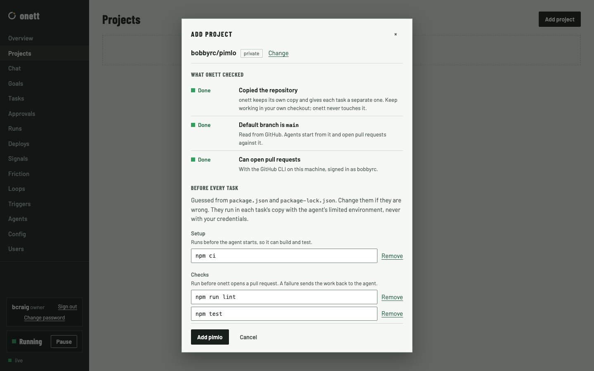
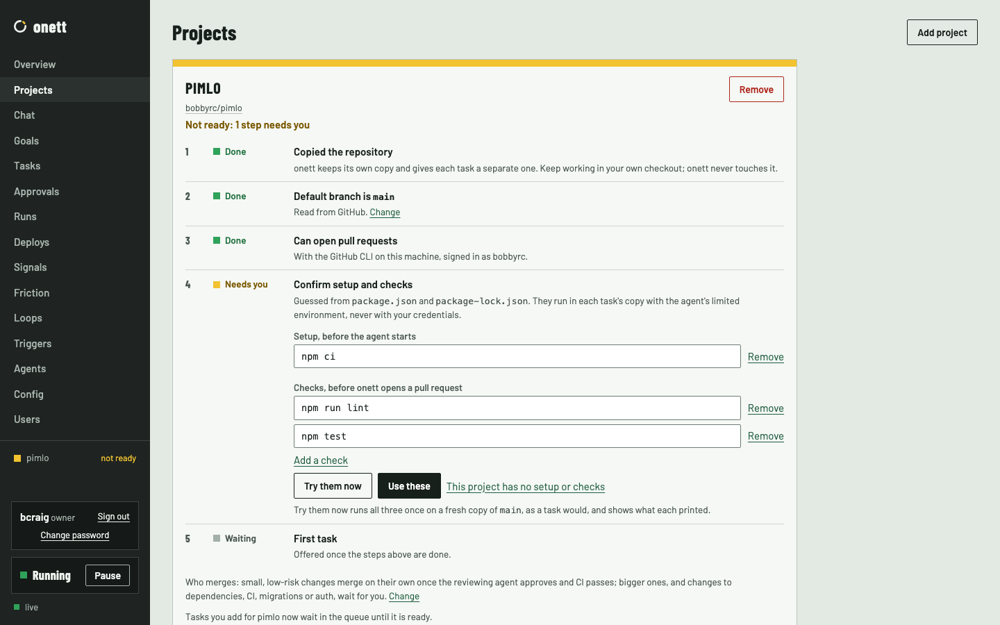

# Adding a project: two directions

A design proposal for how a person adds a repository to onett, from the CLI, the Projects page and
the Config page. Design only: no product code is changed. Written at commit `e75a4bc`.

The owner's brief: "Adding a new project should be very simple, otherwise folks won't want to do
it." They tried to add `bobbyrc/pimlo` and could not tell what the setting for where the
repository lives on disk meant.

**Recommendation: Direction A, "Check, then add".** Reasons under
[Recommendation](#recommendation); the owner's decisions under
[Questions for the owner](#questions-for-the-owner).

## What is here

| File | What it is |
|---|---|
| `mockups/a.html` | Direction A; the state is the URL hash (`a.html#review`) |
| `mockups/b.html` | Direction B, the same way |
| `mockups/a-cli.html`, `mockups/b-cli.html` | each direction's CLI transcript |
| `mockups/add.css`, `mockups/shell.js` | the new pieces only, and the app rail |
| `shoot.mjs` | redraws `shots/` (`node docs/proposals/add-project/shoot.mjs`) |
| `shots/<dir>-<state>-desktop.png`, `-phone.png` | each state at 1440×900 and 390×844 |
| `shots/…-bottom.png`, `…-full.png` | the end of a dialog that scrolls, or the whole page |
| `shots/today-*.png` | today's UI, from the walk-through below |

The mockups load the product's own stylesheets (`web/src/styles.css`, `RailLamps.css`,
`Projects.css`), so fonts, colours, fields, buttons, dialogs and the phone layout are the real
ones. Open them from a checkout. All data is made up; `pimlo`'s files and commands are invented.

## What is wrong today

Walked as a first-time user on a throwaway daemon (temp `HOME` and data directory, port 17853, the
fake harness, `gh` not signed in), at this commit. Every row was seen, not inferred, unless it
says "in the code".

1. **Four ways in, and they disagree.** `onett project add NAME --repo OWNER/NAME [--path]
   [--branch]`; `onett init --project NAME --repo … --path …`; the Projects dialog (name,
   repository, local path, branch, policy, instructions; [today-add-dialog.png](shots/today-add-dialog.png));
   and a "project name" box at the very bottom of the Config page, under one project's 7,355px of
   settings ([today-config-project-full.png](shots/today-config-project-full.png)).
2. **The person must name the project and the repository separately**, name first, though the
   name is almost always the repository's name.
3. **"Local path" invites the trap.** The dialog says "Onett does not clone for you: the
   repository must be there". That is false: onett clones on first need
   (`internal/workspace/workspace.go:148`). It nudges a person to point `path` at their own
   checkout, and onett then rewrites that checkout's `.git/config` to an allowlist, resets its
   `origin` and, when it is clean, detaches its HEAD at `origin/<branch>` (`alignCheckout`, in
   the code). `onett.example.yaml` shows `path: ~/code/onett`, the same trap.
4. **The default branch is assumed to be `main`.** A repository on `master`, added with defaults,
   blocks its first task within seconds, after three attempts, with git's words: `check out
   origin/main in widget: … --detach does not take a path argument 'origin/main'`. Nothing says
   "your branch is `master`".
5. **`onett doctor` says all is well first.** It printed `ok project widget: clone at …` for that
   broken project, and `ok project pimlo: repo bobbyrc/pimlo` without checking that the
   repository exists or can be read. It checks no branch.
6. **`gh` not signed in is invisible in the add flow.** Doctor reports it, but both add paths
   accept the project silently. Within the same minute the Overview feed showed "Issue Intake
   failed" and "Friction failed" for the new project.
7. **Setup and checks are not in the add flow.** Without them an agent gets a worktree with no
   dependencies installed and onett runs no tests before opening a PR. They exist only deep in the
   Config page.
8. **The policy is a bare select ("Default", "default", "supervised") with "Decides what needs
   your approval".** Nothing says what the default does: every change, at any risk, merges once
   the reviewing agent approves and CI passes; a repository with no CI counts as "no CI" after
   three minutes (`require_checks: false`, as `onett.example.yaml` describes it; not exercised here). So a new project with no checks and no CI merges agent
   code on another agent's review alone. The Overview's setup step "Choose a policy" says only
   "the default policy applies" ([today-overview-fresh.png](shots/today-overview-fresh.png)).
9. **Nothing is checked after adding.** The CLI ends with "run `onett config --reload`". The
   Projects page shows the new sheet as "idle", the same as a working project.
10. **The Config page labels settings with their YAML path** (`projects.pimlo.repo`) and says
    "local clone; default <data_dir>/repos/<name>" for path: the words a person was lost in.
11. **Instructions are asked at add time**, though most repositories keep them in `AGENTS.md` or
    `CLAUDE.md`, which agents read anyway.
12. **A local path is accepted as the repository** by every add path, and only doctor says
    afterwards that pull requests need a GitHub repository.

## What both directions decide

These hold in A and in B; the directions differ in when things are saved and where the person
finishes.

- **The one thing a person provides is the GitHub repository.** Picked from a list of their own
  repositories, or typed as `owner/name`, or pasted as a GitHub link. Everything else has a
  default that onett checks or detects.
- **The list comes from `gh` on the server**, the login onett already uses to open PRs. It is an
  owner-session route (`administer`); neither API token can call it, and no agent sees it.
  Signed out: the page says so in one sentence, names the machine, shows `gh auth login` with a
  Copy button and "Check again", and still accepts a typed repository.
- **Name** is the repository's name; editable only under Advanced. **Branch** is detected: from
  GitHub when `gh` is signed in, otherwise from the repository itself (`git ls-remote --symref`,
  which needs no sign-in for a public repository).
- **`path` leaves the add flow** in the UI and the CLI. onett always places its own copy in its
  data directory and says so in one line: "onett keeps its own copy and gives each task a separate
  one. Keep working in your own checkout; onett never touches it." The YAML key stays, for configs
  that set it.
- **Setup and checks are guessed from files, never run to guess, never applied silently.** The
  guess is shown as editable commands with the file it came from. Nothing guessed: the person types
  commands or explicitly chooses "no setup or checks", with what that costs said plainly. The
  commands run as an agent's would (`sysproc.AgentEnv`, in a task copy), and the page says so. The
  rules are a small table, for example:

  | Found | Setup | Checks |
  |---|---|---|
  | `package-lock.json` (or pnpm, yarn, bun lockfile) | `npm ci` (or the matching install) | `npm run lint`, `typecheck`, `test`, whichever scripts exist |
  | `go.mod` | `go mod download` | `go vet ./...`, `go test ./...` |
  | `mise.toml` or `.tool-versions` | prefix the above with `mise exec --` | |
  | `pyproject.toml` with `uv.lock` / `poetry.lock` | `uv sync` / `poetry install` | `uv run pytest` / `poetry run pytest` when `tests/` exists |
  | `Cargo.toml` | `cargo fetch` | `cargo test` |
  | `Makefile` with a `test` target | | `make test` |

  The same rules apply one directory down (`web/package.json` gives `cd web && npm ci`).
- **New projects get the `supervised` policy**, in one sentence: "Small, low-risk changes merge on
  their own once the reviewing agent approves and CI passes. Bigger ones, and any change to
  dependencies, CI, migrations or auth, wait for you." Advanced offers "Everything merges on its
  own" (`default`). This needs the owner's decision; see questions.
- **Instructions move out of the add flow** (Advanced in A; Edit settings in B).
- **After adding, one first task is offered**: a `question` task, "Explain how pimlo is built and
  tested". A question opens no pull request; it makes a task copy, runs setup and has an agent read
  the code, so the owner sees the whole path work before handing over real work. Never started
  without a click.
- **One flow everywhere.** The Projects page has the one form component. The Config page's
  "project name" box goes, replaced by a link to it; the Overview's step 1 opens it. The CLI asks
  the same questions in the same order with the same defaults, and `onett init` offers it.
- **The CLI does not get a new power.** Invariant 12 refuses project changes to the owner token
  the CLI holds, so the CLI keeps editing the file directly, as `onett project add` does today, and
  then asks the daemon to reload. The checks (list repositories, copy, detect) live in one Go
  package that both the API handler and the CLI call, so the two cannot drift.

## Direction A: check, then add

One dialog. The person picks a repository; onett copies it, reads the branch, checks it can open
PRs and guesses setup and checks; the person looks it over and clicks "Add pimlo". **Nothing is
written to `onett.yaml` until every check passes**, so a typo or a signed-out `gh` never leaves a
broken project behind.

| State | Desktop | Phone |
|---|---|---|
| Pick a repository | [shot](shots/a-pick-desktop.png) | [shot](shots/a-pick-phone.png) |
| Checked, guess shown | [shot](shots/a-review-desktop.png) · [end](shots/a-review-desktop-bottom.png) | [shot](shots/a-review-phone.png) · [end](shots/a-review-phone-bottom.png) |
| Advanced open | [shot](shots/a-advanced-desktop.png) · [end](shots/a-advanced-desktop-bottom.png) | [shot](shots/a-advanced-phone.png) · [end](shots/a-advanced-phone-bottom.png) |
| Added, first task offered | [shot](shots/a-ready-desktop.png) | [shot](shots/a-ready-phone.png) |
| `gh` not signed in | [shot](shots/a-signed-out-desktop.png) | [shot](shots/a-signed-out-phone.png) |
| Nothing guessed | [shot](shots/a-no-guess-desktop.png) | [shot](shots/a-no-guess-phone.png) |
| Copy failed | [shot](shots/a-clone-failed-desktop.png) | [shot](shots/a-clone-failed-phone.png) |
| CLI transcript | [shot](shots/a-cli-desktop.png) · [whole](shots/a-cli-desktop-full.png) | [shot](shots/a-cli-phone.png) · [whole](shots/a-cli-phone-full.png) |

- The review step keeps its "Add" button in view while the body scrolls under it.
- Signed out, "Add" stays off: a GitHub project cannot open PRs without `gh`, and A's promise is
  that a saved project works. A public repository can still be checked.
- Nothing guessed: an explicit choice between "Run these commands" and "No setup or checks"; "Add"
  is off until one is made.
- Copy failed: GitHub's own words (redacted, invariant 8), a plain reading of them, a "Did you
  mean" from the person's list, and "Nothing was saved".
- Cancel after a successful copy: onett deletes the copy it just made, unless a project uses it.

**What A needs from the daemon** (all `administer`: owner session only, refused to both tokens)

1. `GET /github/repos` →
   `{"gh":{"signed_in":true,"user":"bobbyrc","host":"apple"},"repos":[{"full_name":"bobbyrc/pimlo","private":true,"description":"…","default_branch":"main","pushed_at":"2026-11-16T19:40:00Z","project":null}]}`.
   Signed out: `{"gh":{"signed_in":false,"host":"apple","fix":"gh auth login"},"repos":[]}`. The
   100 most recently pushed; `project` names an existing project that uses the repository.
2. `POST /projects/inspect` with `{"repo":"bobbyrc/pimlo"}` (strict: unknown fields refused).
   Copies into onett's default place for the derived name (or reuses an existing copy of the same
   repository) and returns
   `{"name":"pimlo","repo":"bobbyrc/pimlo","copy":{"ok":true,"error":""},"default_branch":"main","branch_from":"github","pull_requests":{"ok":true,"gh_user":"bobbyrc"},"guess":{"setup":[{"name":"install","run":"npm ci","from":"package-lock.json"}],"checks":[{"name":"lint","run":"npm run lint","from":"package.json"}],"top_files":["README.md","package.json","src/"]},"suggest":"bobbyrc/pimlo"}`.
   `error` is redacted. A large repository takes a while: the dialog shows "Copying…" with the
   bytes so far, so the route either streams progress or returns an id to poll.
3. `POST /projects` gains `setup` and `checks` (lists of `{"name","run"}`); `name` becomes
   optional (derived from `repo`). It writes through the same validated save path as today.
4. `DELETE /projects/inspect/{name}`: remove a copy made by an inspect that was cancelled.

## Direction B: add now, finish on the project

One field on the Projects page. "Add project" saves at once, **paused**, and the project's sheet
becomes a five-step checklist (copy, branch, pull requests, setup and checks, first task) that
onett works through and the person finishes. Tasks added meanwhile wait. B adds "Try them now":
run the guessed setup and checks once on a fresh copy before confirming.

| State | Desktop | Phone |
|---|---|---|
| Add (one field) | [shot](shots/b-add-desktop.png) | [shot](shots/b-add-phone.png) |
| Checklist, one step needs you | [shot](shots/b-checklist-desktop.png) · [whole](shots/b-checklist-desktop-full.png) | [shot](shots/b-checklist-phone.png) · [whole](shots/b-checklist-phone-full.png) |
| Ready, tried, first task offered | [shot](shots/b-ready-desktop.png) | [shot](shots/b-ready-phone.png) · [whole](shots/b-ready-phone-full.png) |
| `gh` not signed in | [shot](shots/b-signed-out-desktop.png) | [shot](shots/b-signed-out-phone.png) · [whole](shots/b-signed-out-phone-full.png) |
| Nothing guessed | [shot](shots/b-no-guess-desktop.png) | [shot](shots/b-no-guess-phone.png) · [whole](shots/b-no-guess-phone-full.png) |
| Copy failed | [shot](shots/b-clone-failed-desktop.png) | [shot](shots/b-clone-failed-phone.png) · [whole](shots/b-clone-failed-phone-full.png) |
| CLI transcript | [shot](shots/b-cli-desktop.png) · [whole](shots/b-cli-desktop-full.png) | [shot](shots/b-cli-phone.png) · [whole](shots/b-cli-phone-full.png) |

- The rail lamp and the sheet's lamp bar say "not ready" in Call Yellow (a step needs you) or Stop
  Red (a step stopped), always with the words.
- Signed out, the project is added anyway; step 3 stops with the fix, and "Check again" re-runs it.
- Copy failed: the project is in `onett.yaml`, paused; the person removes it or changes the
  repository.

**What B needs from the daemon**

1. `GET /github/repos`, as in A (`administer`).
2. `POST /projects` with only `{"repo":"bobbyrc/pimlo"}`: derives the name, writes the project
   with `policy: supervised` and `paused: true`, reloads, and starts the checks in the background.
3. `GET /projects/{name}/readiness` (`read`) →
   `{"steps":[{"key":"copy","state":"done","detail":"…"},{"key":"branch","state":"done","value":"main","from":"github"},{"key":"pull_requests","state":"stopped","detail":"…","fix":"gh auth login"},{"key":"setup_checks","state":"needs_you","guess":{…}},{"key":"first_task","state":"waiting"}]}`,
   plus an SSE event when it changes.
4. `POST /projects/{name}/readiness/check` (`operate`, refused to the agent token): run the checks
   again.
5. `POST /projects/{name}/trial` with `{"setup":[…],"checks":[…]}` (`operate`, refused to the
   agent token): run them once in a throwaway worktree with `sysproc.AgentEnv`; returns each
   command's result, time and redacted output tail.
6. "Use these" writes `setup` and `checks` and removes `paused` through the existing config save
   (`PATCH /config/document`), so it stays an owner-session change.

## Side by side

| | A: check, then add | B: add now, finish on the project |
|---|---|---|
| Saved to `onett.yaml` | only once every check passes | at once, paused |
| A typo or signed-out `gh` | nothing saved; fix and retry in the dialog | a broken, paused project to fix or remove |
| Where the person finishes | the same dialog | the project's sheet, any time later |
| Proves setup and checks run | no (the first task does) | yes, "Try them now" |
| CLI | one command, interactive or with flags | `add`, then `ready` (and `status`, `check`) |
| New routes | 2 (+2 fields, +1 cleanup) | 4 (+1 changed) |
| New state in onett | none | "not ready" (paused plus readiness) |

## Recommendation

**Build Direction A.**

- **It is the simplest thing that works**, which is the brief: one dialog, one decision when the
  guess is right ("Add pimlo"), and the CLI is one command with the same questions.
- **A saved project works.** onett never writes a project it could not copy, whose branch it did
  not read, or that cannot open PRs. B saves first and then must explain, on the Projects page, a
  project that is in the config but not usable; that is a second state for every page, loop and
  doctor check to understand.
- **Fewer moving parts.** No readiness model, no background checker, no paused-for-onboarding
  meaning layered on `paused`. Two routes, both owner-only.
- **What A gives up**: B's "Try them now". The first task covers most of it (a question runs
  setup), and a "Try setup and checks" button can be added later to the project's Edit settings
  without changing A.

## Questions for the owner

1. **Direction A or B?** Recommended: A.
2. **Which policy does a new project get?** Recommended: `supervised` written into the new
   project's block, because today's default merges everything, even with no checks and no CI.
   The alternative keeps `default` and says what it does in the same plain sentence.
3. **Should `path` go from the CLI flags and the UI entirely**, leaving only the YAML key?
   Recommended: yes. And should onett refuse a `path` that is a person's working checkout (another
   `origin`, or uncommitted work), instead of rewriting its git config and moving its HEAD?
4. **May the add flow copy the repository before the project is saved** (A), deleting the copy on
   Cancel? It is the only way to read the branch and the files without `gh`.
5. **Is the suggested first task right**, a one-click `question` task, never started by itself?
6. **Does the Config page lose its "project name" add box** (replaced by a link to the one form),
   and should its project section lead with plain labels, the YAML path secondary?

## Not checked

- That a `question` task runs project `setup` and ends without a PR: inferred from the run path,
  not exercised here.
- `gh repo list` paging and speed for accounts with many repositories or organisations.
- Copy progress for a large repository: the mockups do not draw it.
- The dark scheme: shots are light only.
