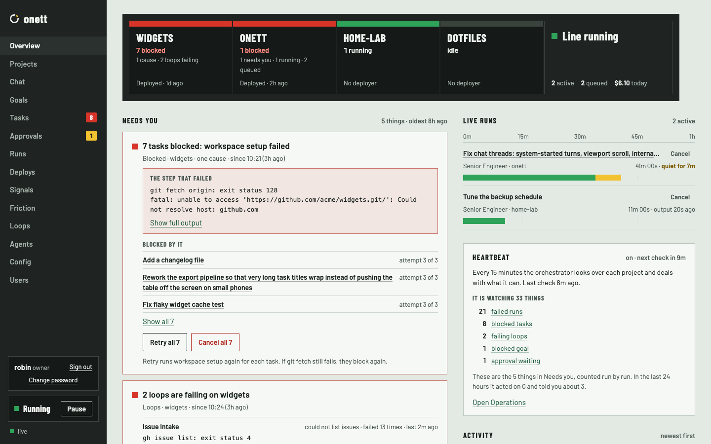
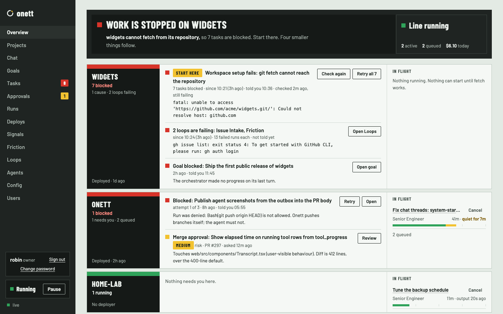

# Overview page: two directions

A design proposal for the Overview page (`/`), the page the owner lands on to see what needs
them. Design only: no product code is changed. It follows the UI audit of 12 November 2026
(problems 2, 6, 14, 15 and 16; choices 1, 6 and 7), at commit `8eb4637`.

**Recommendation: Direction A, "Work the list".** The reasons are under
[Recommendation](#recommendation). The owner's decisions are under
[Questions for the owner](#questions-for-the-owner).

## What is here

| File | What it is |
|---|---|
| `a-fresh.html`, `a-busy.html`, `a-bad.html` | Direction A in three states |
| `b-fresh.html`, `b-busy.html`, `b-bad.html` | Direction B in three states |
| `mock.css` | styles for the new pieces only |
| `shots/<page>-desktop.png`, `shots/<page>-phone.png` | the first screen at 1440×900 and 390×844 |
| `shots/<page>-desktop-full.png`, `shots/<page>-phone-full.png` | the whole scrolling page |

The mockups are static HTML with no script. They load the product's real stylesheet
(`web/src/styles.css`), so the colours, fonts, board, cards, buttons and phone layout are the
real ones; `mock.css` adds only what a direction proposes. Open a file from a checkout of the
repository, or the stylesheet link will not resolve. All data is made up.

The three states:

- **Fresh install**: no project, eight agents ready, only the log notifier (so onett cannot reach
  the owner), no tasks.
- **Busy day**: four projects; one blocked task and two merge approvals wait on the owner; three
  runs are active; one setup step is left.
- **Bad day**: seven tasks on `widgets` are blocked because `git fetch` cannot reach the
  repository; two loops (the daemon's periodic jobs, here issue intake and friction filing) fail
  on `widgets` because the GitHub CLI is not signed in; a goal is blocked; on `onett` one more
  task is blocked for its own reason and one approval waits.

## What is wrong today

Checked two ways. `npm run shots` (the real UI over mocked data) was run for the Overview page
and the result read. For the states the mocked data does not have, the code was read and compared
with the audit's screenshots of a real daemon at this same commit. A daemon was **not** run again
for this proposal.

| Audit # | Confirmed | How |
|---|---|---|
| 2: a blocked card's reason cannot be acted on, and seven cards repeat it | yes, in the code | `internal/engine/runner.go:233` passes two things: the words "workspace setup failed" and the real error. `internal/engine/helpers.go:203` puts only the words into the task's `blocked_reason`. The real error is added to the task's body when the task is re-queued, and dropped on the last attempt. |
| 6: a failed loop fills the feed; run rows do not say which run | yes, in the code | `internal/engine/loops.go:239` sends "loop name: error", and the error already begins with the loop's name, the command line and the tool's whole output. A run row's text is the word "run" plus the status (`internal/engine/runner.go:986`). |
| 14: the setup card stays open on desktop | yes, in the running UI | With one step left the card is 248px tall and Needs you starts 515px down a 900px screen. |
| 15: "Needs attention 29" is unexplained | yes, in the running UI and the code | The number is the length of the heartbeat's list (`internal/engine/heartbeat.go:307`). The heartbeat is the loop that wakes the orchestrator agent to look over a project. Its list counts every blocked task, every failed run of a task that is still open, every blocked goal and every pending approval as one item each. So 29 is most likely 7 blocked tasks, their 21 failed runs and 1 blocked goal; that sum was not checked against a live daemon. |
| 16: a task shown as an ID chip | yes, in the running UI | The approval card on Overview says "task R9T3WZ5B" under a title that is already the task's title. |

Problems on this page that the audit did not list:

1. **A blocked goal is not in Needs you.** It appears only inside the red "Nobody will be told"
   banner. Once a channel is set up the banner goes, and the blocked goal is nowhere on the page.
   `/stats` already sends `blocked_goals`.
2. **A failing loop is not in Needs you either.** It is one row in Activity, which scrolls away
   after ten newer rows, and a line on the Loops page. The Heartbeat card shows only the heartbeat
   loop's own error. `/loops` already sends every loop's `last_error`.
3. **Activity times have no date.** In the mocked page a row from yesterday (10:00:00) sits below
   one from today (09:00:00).
4. **Activity is mostly plumbing.** In the audit's live page seven of the ten rows are the steps
   of one heartbeat check ("run running", "message reached the orchestrator", "orchestrator chat
   run starting").
5. **"Line running" with a green lamp while every task is blocked and nothing is active.** It
   means "not paused", and reads as "all is well".
6. **"7 waiting" counts cards, not things to do.** One cause reads as seven jobs.
7. **The setup step "Reach me" and the red banner say one thing twice**, and the step points at
   the banner ("see the warning on this page").
8. **The daemon's project check is not shown.** `/stats` sends `preflight`: per project, whether
   its tool directories can be read, with the error and a suggested fix. The web UI shows it
   nowhere. It is the one place where the daemon already names a cause and a fix.

## Direction A: work the list

Today's page with each part fixed. The board stays on top, Needs you stays on the left and is a
list to work through from the top, and the owner acts in place.

| State | Desktop | Phone |
|---|---|---|
| Fresh install | [first screen](shots/a-fresh-desktop.png) · [whole page](shots/a-fresh-desktop-full.png) | [first screen](shots/a-fresh-phone.png) · [whole page](shots/a-fresh-phone-full.png) |
| Busy day | [first screen](shots/a-busy-desktop.png) · [whole page](shots/a-busy-desktop-full.png) | [first screen](shots/a-busy-phone.png) · [whole page](shots/a-busy-phone-full.png) |
| Bad day | [first screen](shots/a-bad-desktop.png) · [whole page](shots/a-bad-desktop-full.png) | [first screen](shots/a-bad-phone.png) · [whole page](shots/a-bad-phone-full.png) |

- **What the owner does first.** The top card of Needs you. The list is ordered: blocked work
  before approvals, the cause that blocks the most tasks first, then the oldest. On a fresh
  install the setup card is the page, and its first unfinished step holds the only filled button
  ("Add a project").
- **One cause behind seven tasks.** One card: "7 tasks blocked: workspace setup failed". It shows
  the step that failed and the tool's own words once, lists the tasks under it (three, then
  "Show all 7"), and has "Retry all 7" and "Cancel all 7". Retry is a plain outlined button, not
  the filled one, with a line under it saying it will block again if the cause is still there:
  the owner has to fix the cause outside onett first, and the page should not invite a retry
  before that.
- **How much of a loop error.** A failing loop becomes a Needs you card, one per project. Each
  loop gets one row: its name, what it could not do, how often it failed, and the first two lines
  of the tool's output. The rest is behind "Show full error". In Activity a failing loop is one
  line, and repeats fold into it ("13 times since 10:24").
- **The "needs attention" number.** The Heartbeat card says what the heartbeat is in one
  sentence, then "It is watching 33 things" with the count by kind (21 failed runs, 8 blocked
  tasks, …). Each kind is a link to that filtered list. A line under it says these are the same
  five things as in Needs you, counted run by run. "Open Operations" still leads to the
  conversation where the orchestrator reports.
- **Also changed.** The setup card folds to one line at the top once a project exists (audit
  choice 6). On a fresh install the red banner is gone and its text is the "Reach me" step: with
  no project nothing can need the owner yet. A blocked goal is a Needs you card. The approval
  card loses the ID chip; its title links to the task. Activity is a time and one sentence that
  names its task, with the project at the right and a weekday on older rows.

**What the daemon would have to send that it does not send today**

1. The cause of a block as its own field on the task: the underlying error text, apart from the
   one-line reason. It must be redacted like any other command output (invariant 8).
2. A stable key for that cause, so the UI can tell that seven tasks share it without comparing
   sentences.
3. A loop's error in parts (what it was doing in words, the command, the exit status, the tool's
   output), plus when the loop started failing and how many times since. Today it is one string.
4. The heartbeat's count by kind. Today it is one number.
5. The task's title on events about a run. Today the text is "run running"; the UI could look
   each title up, at one request per row.

Without any of these, A can still ship in a weaker form: group cards whose project and reason
text are equal, show a loop's raw error cut to three lines, and keep the bare number with the
sentence that explains it. "Retry all" needs no new route: it is the existing retry, once per task.

## Direction B: read the board

The page becomes the andon board (the lamp board with one window per project). A sentence on top
says where to start. Under it each project is a lane: its board window, then what needs the owner
there as short rows, then what is running there. The owner reads the whole factory on one screen
and opens a thing to act on it.

| State | Desktop | Phone |
|---|---|---|
| Fresh install | [first screen](shots/b-fresh-desktop.png) · [whole page](shots/b-fresh-desktop-full.png) | [first screen](shots/b-fresh-phone.png) · [whole page](shots/b-fresh-phone-full.png) |
| Busy day | [first screen](shots/b-busy-desktop.png) · [whole page](shots/b-busy-desktop-full.png) | [first screen](shots/b-busy-phone.png) · [whole page](shots/b-busy-phone-full.png) |
| Bad day | [first screen](shots/b-bad-desktop.png) · [whole page](shots/b-bad-desktop-full.png) | [first screen](shots/b-bad-phone.png) · [whole page](shots/b-bad-phone-full.png) |

- **What the owner does first.** The sentence on the board says it ("Work is stopped on widgets
  … Start there"), and the row it means carries a "Start here" tag. Lanes are sorted worst first,
  so that row is the first one. On a fresh install the five setup steps are a row of stations and
  the first one is outlined.
- **One cause behind seven tasks.** A row is a problem, not a task: "Workspace setup fails: git
  fetch cannot reach the repository · 7 tasks blocked". The tasks are a number on that row. It has
  "Check again" (try the failed step without retrying the tasks) and "Retry all 7".
- **How much of a loop error.** At most three lines of the tool's output on the row, with no
  "show more" on this page; the full error is on the Loops page. One line was tried first and cut
  off the part that mattered ("Could not resolve host"), which is why it is three.
- **The "needs attention" number.** It is not on the page. Its meaning moves onto each row as
  "told you 10:36" or "not told yet", and the Orchestrator card says how often it told the owner
  and acted in the last day. The count itself would stay on the Loops page.
- **Also changed.** Approvals are rows with a "Review" button that opens the task: the owner does
  not approve from Overview, because a row has no room for the risk reasons and the commit an
  approval covers. Live runs sit in their project's lane. Projects with nothing going on fold
  into one "Quiet" line. The setup card is one line below the lanes (audit choice 6). Activity is
  the same as in A.

**What the daemon would have to send that it does not send today**

Items 3 and 5 of Direction A, and:

1. Problems as the daemon's own list per project: what is wrong in one line, the underlying
   error, since when, which tasks it blocks, and whether the owner was told. The sentence on the
   board and every row are built from it. In A the UI can group tasks itself; in B the page has
   nothing to show without this list.
2. A way to check a cause again without spending a task's attempt, and the time and result of the
   last check ("checked 2m ago, still failing").
3. For each thing the heartbeat tracks, whether and when the owner was told. The daemon keeps
   this already and does not send it.

## Side by side

| | A: work the list | B: read the board |
|---|---|---|
| Organised by | urgency, one list | project, one lane each |
| Acting | on the page (approve, retry) | approvals open the task; retry stays on the page |
| Bad day, desktop first screen | the cause card and the start of the next | every lane that needs the owner |
| Bad day, phone page height | 3,981px | 2,796px |
| Busy day, phone page height | 3,468px | 2,635px |
| Works with today's daemon | mostly, in a weaker form | no |
| Size of the build | each existing part changed in place | a new page layout and a new daemon list |

For scale: today's page in the audit's all-blocked state is 3,536px tall on a phone, with seven
identical cards. A's bad day is taller than that because this made-up day has more kinds of
trouble on it; the seven tasks themselves take one card.

## Recommendation

**Build Direction A.**

- The owner comes to this page to act. A keeps approving and retrying on the page. B turns every
  approval into a second page.
- A is the page the owner already knows with each complaint answered where it arose, so it is a
  small build, and each part can ship on its own.
- A still helps when the daemon sends nothing new. B's sentence on the board and its "Check
  again" promise knowledge the UI does not have today, so B cannot be built honestly until the
  daemon owns a list of problems.
- B's short rows turned out tight. A tool's message needs three lines to reach its point, which
  is most of what A's card shows anyway.

What B does better: the whole factory fits one screen, it reads well with many projects, and
each row says whether the owner was already told. The last is worth adding to A's cards later
("told you 10:36" in the line under the title); it needs item 3 of B's daemon list.

## Questions for the owner

1. **Direction:** A (recommended) or B?
2. **The cause of a block** (audit choice 1): may the daemon send the underlying error and a
   cause key as their own fields? The text is built in `internal/engine/helpers.go`, a file rated
   high risk, so the change needs your approval. If not now, A ships with cards grouped by equal
   reason text and no cause shown.
3. **Order of Needs you:** blocked work first (most tasks first), then approvals, oldest first?
   Or approvals first, because they are quick?
4. **Retry all and Cancel all:** should "Retry all 7" ask for confirmation? Should "Cancel all 7"
   be on Overview at all?
5. **Failing loops** (audit choice 7): is a failing loop something that needs you (a red card in
   Needs you, as drawn), or only a matter for the board and the feed? Are two lines of the tool's
   output, with the rest behind "Show full error", the right amount?
6. **The heartbeat number:** explain it with the count by kind and links (A), or take it off
   Overview (B)? Is "watching" the right word for it?
7. **Setup card** (audit choice 6): one line at the top (A) or below the work (B)? On a fresh
   install, may the red "Nobody will be told" banner become the "Reach me" step until a project
   exists?
8. **Activity:** replace the event-type column with one sentence, fold repeats into one row, and
   leave out the plumbing rows (run starting, message reached the orchestrator)?
9. **Blocked goals:** show them in Needs you?

## Not covered

- The dark theme: the mockups were shot in the light theme only. They use the real tokens, so
  dark should follow, but it was not looked at.
- Widths between phone and desktop, the viewer and operator roles, and keyboard and screen-reader
  use of the new pieces.
- The rate-limit note under the board, which neither direction changes.
- The agent's name in Live runs ("Chat with Chief of Staff") is left as it is today; that is
  audit choice 3, outside this page.
- The Go change itself. This proposal names what the daemon would have to send, not how.
